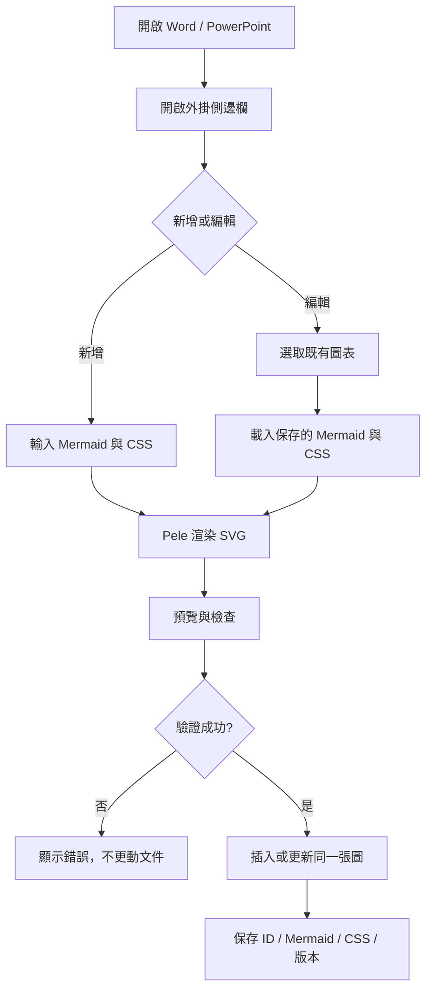
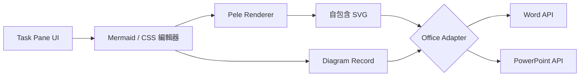

# Office Mermaid + Pele 外掛 — MVP 需求規格

> 文件用途：提供開發 Agent 作為第一版實作依據。  
> 狀態：需求確認，尚未開始實作。  
> 語言：繁體中文。

## 1. 專案目標

建立 Microsoft Office Add-in，讓使用者在 **Word 與 PowerPoint** 中輸入 Mermaid 語法，透過已安裝的 **`pele`** 套件渲染為 SVG，並可用 **Pele 支援的 CSS／主題設定**控制圖形樣式。使用者日後選取已插入的圖表，能在外掛側邊欄重新載入 Mermaid 原始碼與 CSS、修改並更新**同一張圖**。

核心原則：**輕量、純前端、可離線查看文件、原始碼隨文件保存、不依賴後端服務。**

## 2. 已確認的開發前提

- 已使用 Microsoft Office Add-in Generator 建立專案。
- Manifest 類型：**Add-in only manifest**（XML）。
- 使用 **pnpm** 管理依賴；`pele` 套件已安裝。
- 原先提及的 `@pelejs/core` 並不存在；**不要安裝或引用該套件**。
- 以現有專案的框架、目錄、建置工具、Office.js 設定為準；**不要重新建立專案**，也不要擅自改成 Vite。
- 使用者不一定安裝桌面版 Microsoft Office；須讓非 Office 環境下的 Pele 編輯器與預覽可獨立測試。真正的 Office 文件操作仍須在支援的 Word / PowerPoint 宿主環境測試。

## 3. MVP 功能範圍

### P0 — 必須完成

1. **外掛側邊欄（Task Pane）**
   - Mermaid 多行文字編輯框。
   - CSS／Pele 主題樣式多行文字編輯框。
   - SVG 即時預覽區。
   - 「新增／插入圖表」、「載入選取圖表」、「更新圖表」按鈕。
   - Mermaid 語法錯誤及渲染失敗的清楚提示；失敗時不覆蓋原圖。
2. **Pele 渲染**
   - 使用已安裝的 `pele` 套件將 Mermaid 文字渲染成 SVG。
   - 依照實際 Pele API 支援 CSS／主題變數；不要假設任意 CSS 都可直接傳入渲染器。
   - 插入 Office 前將樣式內嵌或解析成自包含 SVG，避免依賴外掛頁面的外部 CSS。
3. **Word 插入與重新編輯**
   - 在目前文件插入 SVG 圖形。
   - 為每張圖表建立穩定唯一 ID，保存 Mermaid 原始碼、CSS／主題資料與必要版本資訊。
   - 選取既有外掛圖表後，可載入其 Mermaid 與 CSS。
   - 更新時取代**同一張圖表**，避免每次都新增圖片。
   - 儲存、關閉、重新開啟文件後，仍可找回並更新原始資料。
4. **PowerPoint 插入與重新編輯**
   - 與 Word 相同的插入、載入、更新及重新開啟後可編輯流程。
   - 允許 PowerPoint 使用不同的 Office API 適配器及中繼資料策略。
5. **無外掛可讀**
   - 文件中保留正常可見的 SVG；收件者沒有安裝外掛，也能查看圖表。

### P1 — 後續版本，不納入第一版

- Excel 支援。
- 整份文件統一 CSS 主題與批次換色。
- CSS 主題範本管理與匯入匯出。
- 自動偵測圖形點擊並彈出編輯器（第一版可由使用者先選取圖形，再按「載入選取圖表」）。
- Mermaid 原始碼匯入／匯出。

### 不做

- 將 SVG 轉換成 PowerPoint 原生可逐一編輯的 Shapes。
- 後端 API、雲端資料庫、登入系統。
- 複雜圖形拖拉編輯器。

## 4. 主要使用流程



## 5. 資料模型（概念）

每張由外掛管理的圖表至少具有：

```ts
interface DiagramRecord {
  id: string;                 // 穩定且唯一的圖表 ID
  mermaidSource: string;      // Mermaid 原始碼
  cssSource: string;          // CSS／Pele 樣式原始文字
  schemaVersion: number;      // 資料結構版本
  rendererVersion?: string;   // Pele 版本，可選
}
```

> 此介面只是資料契約範例，不強制實作名稱或儲存格式。**資料必須保存在 Office 文件內**，不可只放在 localStorage 或外掛記憶體中。

### 文件內儲存策略

- Word：優先評估 Content Controls 搭配文件內中繼資料；需實測其與 SVG 插入、選取、更新的相容性。
- PowerPoint：研究 Shape 識別、替換及文件層級中繼資料的正式 Office.js API；不能假設 Word 的做法可直接複用。
- 不能只用圖形位置或順序當 ID，因為使用者會移動、複製、刪除圖形。
- 若 Office.js 在某宿主無法可靠完成「選取圖表 → 找回原始碼 → 更新原圖」，必須明確列出限制與替代方案，不得假裝已支援。
- 更新時需考慮保留原圖位置與尺寸；若無法完全保留，需在 UI 明確提示。

## 6. 技術架構



建議模組職責：

- **UI**：文字編輯、預覽、錯誤訊息、按鈕狀態。
- **Pele Renderer**：將 Mermaid + 支援的主題設定轉成 SVG；與 Office API 解耦。
- **SVG Export**：處理樣式、字型、尺寸及安全性，輸出 Office 可接受的自包含 SVG。
- **Office Adapter**：Word / PowerPoint 各自實作插入、選取、查找、替換與資料保存。
- **Diagram Store**：文件內資料版本化、圖形 ID 與原始碼關聯。

## 7. 非功能需求

- **純前端優先**：Pele 渲染不需後端服務；Office Task Pane 本身仍由 WebView 承載。
- **安全性**：對使用者輸入的 Mermaid、CSS 與 SVG 做必要驗證與清理；避免 SVG 內嵌腳本、事件處理器、外部資源載入等風險。
- **穩定性**：渲染或插入失敗不可破壞既有圖表資料。
- **相容性**：先驗證使用者實際使用的 Office 平台；不要預設所有 Windows / Mac / Web 版本都支援同一組 API。
- **效能**：輸入時預覽可 debounce；不要每次按鍵都寫入 Office 文件。
- **可維護性**：Renderer 與 Office Adapter 分離，為未來 Excel 留擴充空間。
- **依賴管理**：維持 pnpm；不要執行會造成破壞性升級的 `npm audit fix --force`。

## 8. 驗收標準

- [ ] 不開 Office 時，可在一般瀏覽器開發／測試 Mermaid + CSS → SVG 預覽。
- [ ] 在 Word 插入 Mermaid SVG，文件中顯示正確。
- [ ] 在 Word 選取圖表，可載入 Mermaid 與 CSS，修改後更新原圖。
- [ ] Word 文件儲存、關閉、重開後，原始碼仍可載入並更新。
- [ ] 在 PowerPoint 完成相同的插入、選取、更新及重開測試。
- [ ] 不安裝外掛時，Word / PPT 仍能顯示已插入的 SVG。
- [ ] CSS 樣式在預覽及 Office 中盡可能一致，已知差異有文件記錄。
- [ ] Mermaid 語法錯誤時顯示錯誤，且不覆蓋既有圖表。
- [ ] 多張圖表共存時，修改其中一張不影響其他圖表。

## 9. Agent 執行順序

1. **先檢查現有專案**：`package.json`、manifest、src 目錄、框架、建置指令、`pele` 實際 API 與型別。
2. **建立 Pele 渲染與獨立預覽**：先驗證 Mermaid → SVG、CSS／主題支援範圍及 SVG 自包含輸出。
3. **實作 Task Pane 編輯介面**：兩個文字框、預覽、錯誤提示、插入／載入／更新按鈕。
4. **Word 端到端驗證**：插入 → 存檔 → 關閉 → 重開 → 載入 → 更新同一張圖。
5. **PowerPoint 端到端驗證**：採用 PowerPoint 適用的 API 完成相同流程。
6. **測試及文件化**：補上測試步驟、已知限制、開發啟動指令、平台相容性。

## 10. Agent 特別注意事項

- **不要重建專案**；直接在使用者已建立的 Office Add-in 專案中開發。
- **不要引用 `@pelejs/core`**；已安裝的 npm 套件名稱是 `pele`。
- 不要自行猜測 Pele 的 `render()`、CSS 注入、子路徑匯入等 API；以本地已安裝版本的文件／型別為準。
- 不要假設 Office.js 能直接將 SVG 轉成 PowerPoint 原生 Shapes。
- 不要把「SVG 可以插入」當成「SVG 可持久化重新編輯」已完成。
- 如果關鍵 Office API 受限，先提供最小可重現驗證及技術選項，再決定替代設計。
- 優先做出能驗證的完整垂直流程，而不是只做漂亮的 UI。

## 11. 第一版完成定義

**Word 與 PowerPoint 均能：輸入 Mermaid + CSS → Pele 預覽 → 插入 SVG → 存檔重開 → 選取圖表 → 還原原始碼 → 修改並更新同一張圖。**

這是 MVP 的核心成功條件。
